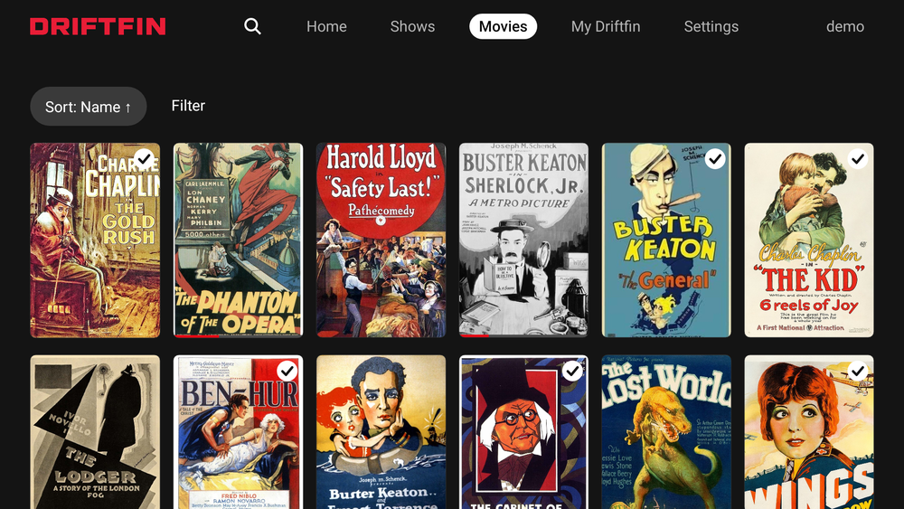

# Driftfin

An Android TV client for your own Jellyfin server, with a TV-first layout (home rows, hero banner, My List, details, search, player). Not affiliated with Jellyfin.

**Status: alpha, TV-only.** Expect rough edges and bugs. It is unit-tested and snapshot-tested, and it has had hands-on use on one Android TV, but that is not broad device coverage. Playback, HLS transcodes, subtitle loading, remote-control focus and scrolling smoothness are still being checked on real hardware, and known issues are open. Do not rely on it as your only way to watch.

## Screenshots

Demo data with synthetic placeholder artwork; on your server these are your own titles and artwork.

## What makes Driftfin different

Driftfin puts browsing first, with artwork-led discovery and a layout designed for a TV remote.

- Discover something unwatched. Home's rotating banner highlights highly rated unwatched movies, alongside Continue Watching, Next Up, Recently Added and Favorites.
- Explore the cast without stopping playback. Press Down while paused to browse cast, then open an actor's page to explore their movies and shows in your library.
- See your library's artwork and formats. Title logos appear when available, with 4K, HDR and Dolby Vision badges drawn from file metadata.
- Stay oriented with the remote. D-pad navigation, visible focus and remembered positions help you move around without starting over.

Driftfin is still in alpha. Its focus is making your Jellyfin library feel good to browse on a TV, rather than promising every feature found in other clients.

## What it does

- Sign in with server address, username and password (profile chips list the server's public users when the server shows them).
- Home rows: My List (your Jellyfin favorites), Continue Watching, Next Up, Recently Added, More like (last watched), libraries.
- Details with seasons and episodes, Play/Resume, mark watched, My List.
- Search, Shows, Movies, My List, Settings tabs.
- Player: seek, audio and text subtitle selection, playback speed, autoplay next episode (switchable).
- Skip Intro: shows a bottom-right button during an intro that your Jellyfin server has marked (Media Segments, server 10.10 or newer), and only skips when you press OK. It appears only where the server has segment data. Switchable in Settings.
- Title logos on Home and Details where Jellyfin has a logo image, with plain text otherwise. Switchable in Settings.
- HDR and Dolby Vision tags beside the 4K tag on a movie's Details page, read from the file's video stream metadata (shows what the file contains, not what the TV outputs; hidden when the metadata is missing or only says the Dolby Vision data is invalid). Switchable in Settings.
- Actors: select a cast member on Details to see their movies and shows on your server (as the signed-in user sees them) and their Jellyfin biography when there is one. While a video is paused, press Down to browse the cast and OK to open an actor; Back returns to the paused video. Switchable in Settings ("Cast while paused"). The paused-video handoff has been checked only by unit tests of the key logic and renders, not on a TV.
- Saved profiles: a profile you signed in with stays on the TV (encrypted) so you can switch back without the password. "Sign out and forget this profile" removes it. It does not revoke the token on the server.
- Check for updates (bottom of Settings): only when you ask. It reads the latest GitHub release, downloads the APK, checks its checksum, package name, version and signing certificate, and then opens Android's installer, which asks you to confirm. Android may first ask you to allow installs from Driftfin. The installer step has not been tested on a TV.

## Install

Driftfin is an APK you sideload. You need an Android TV or Google TV and a Jellyfin server you can reach from it.

**With Downloader (easiest on a TV)**

1. Install the free **Downloader** app from your TV's app store.
2. Open Downloader and allow it to install apps from unknown sources when Android asks (Settings, then the install-unknown-apps permission for Downloader).
3. In Downloader's address box, type this link and select Go:
   `https://github.com/dhrandy/Driftfin/releases/latest/download/jetflix-release.apk`
4. When the download finishes, select Install, then Open.

Typing a long link with a remote is slow. The same file is on the [releases page](https://github.com/dhrandy/Driftfin/releases/latest), and you can also download it on a computer and copy it to the TV with a USB drive or `adb install`.

**Updating.** Open Settings in Driftfin and select "Check for updates" at the top. It installs over the current version and keeps your profiles. If the installer step does not work on your TV, download the APK again with Downloader: installing over the existing app keeps your data.

Each release page lists a SHA-256 file next to the APK if you want to check the download.

## Limits

- Text subtitles only (SRT, WebVTT, ASS/SSA). Picture subtitles are not supported.
- No downloads or kids/PIN profiles. No recommendation engine; "More like" is Jellyfin's similar-items list.
- Trailers play from the details page when the server has them.
- Server addresses may use plain `http://`, which is common on a home network. Sign-in details and the access token then travel unencrypted on that network, so use `https://` for anything outside your own LAN.

## Build

Android SDK 35, JDK 17, Gradle 8.10.2. `gradle testDebugUnitTest assembleDebug`. Snapshot tests render with Paparazzi; real artwork fixtures are not included in this repository, so renders show placeholders.

## Releases and signing

The workflow in `.github/workflows/android.yml` builds a signed release APK from repository secrets (`JETFLIX_KEYSTORE_B64`, `JETFLIX_KEYSTORE_PASSWORD`, `JETFLIX_KEY_ALIAS`, `JETFLIX_KEY_PASSWORD`). It refuses to build without them. No key is stored in the repo.

## License

Copyright (c) 2026 dhrandy. All rights reserved. Driftfin's own code and original assets are proprietary for builds published after build 24; no open-source license is granted for them. Build 24 and earlier were published under MIT, and that grant is unchanged for those builds. Third-party libraries and artwork are not covered and keep their own terms; see [THIRD_PARTY_NOTICES.md](THIRD_PARTY_NOTICES.md). Driftfin is an independent project, not affiliated with Jellyfin.

Movie and TV show posters belong to their respective copyright owners. Driftfin does not claim ownership of that artwork.
